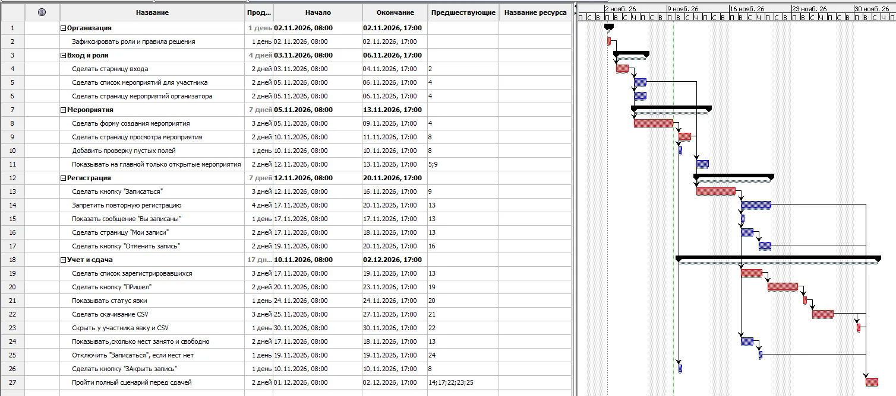
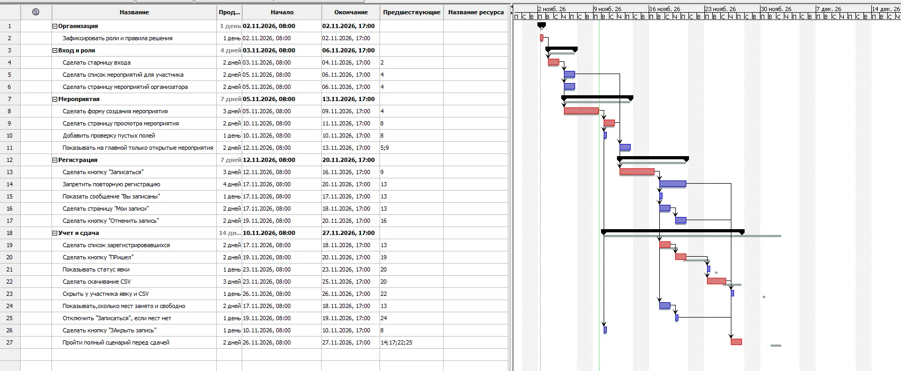

# Система регистрации и учёта участников мероприятий

Календарный план системы регистрации. Начало — 2 ноября 2026, рабочие дни — с понедельника по пятницу. Следующая работа начинается только после окончания предыдущей.

### Исходный план
Окончание: **2 декабря 2026**

**Красная цепочка:** роли, вход, форма мероприятия, страница мероприятия, кнопка «Записаться», список участников, «Пришёл», статус, CSV, скрытие кнопок и проверка сценария.

**Синие работы** можно немного задержать. Это сообщение «Вы записаны» и кнопка «Закрыть запись»: список, явка и файл от них не зависят.
Запрет повторной записи длится 4 дня. Работе нужно 8 часов, а исполнитель может заниматься ею только по 2 часа в день.

### Как читать схему
Слева список работ. 

Жирная строка — этап, под ней работы этого этапа. В столбце «Предшествующие» номер работы, которую нужно закончить раньше.
Справа те же работы полосками. 

Чёрная полоска — весь этап. 

Красная — критический путь: задержка этой работы сдвигает дату сдачи. 

Синяя — у работы есть запас, небольшая задержка дату не меняет. Стрелка ведёт к следующей работе.

### План после сокращения
Окончание: **27 ноября 2026**, на три рабочих дня раньше.
Срок сокращен тремя решениями:
1. Список участников делают два человека, поэтому работа занимает 2 дня вместо 3.
2. Файл CSV начинают сразу после кнопки «Пришёл», не дожидаясь надписи на экране.
3. Проверку сценария ведут одновременно со скрытием кнопок у участника.
Обязательные работы не удалялись. Последствие: людям нужно заранее разделить работу, проверить колонки в файле и отдельно зайти под участником.

